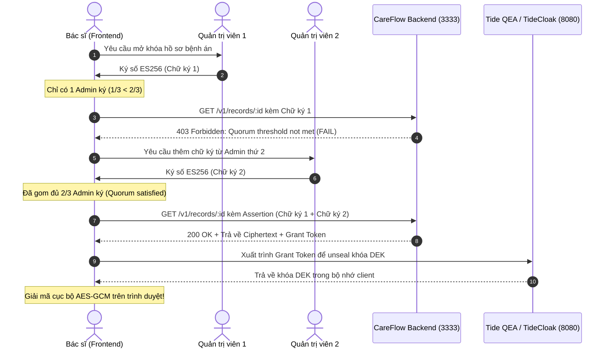

# CareFlow Frontend Integration Guide

> **Mục tiêu:** Hướng dẫn đội ngũ Frontend tích hợp ứng dụng với CareFlow Backend API theo chuẩn **RFC 9449 (DPoP)**, xử lý xung đột đồng thời (**Race Condition / 409 Conflict**), và thực thi luồng bảo mật **Tide QEA Multi-Admin (2/3 Admin)** kết hợp mã hóa cục bộ (**Client-Side KMS Decryption**).

---

## 1. Thông số Hệ thống & Tài nguyên API

| Thành phần | URL / Cổng | Ghi chú |
| :--- | :--- | :--- |
| **Backend API** | `http://localhost:3333` | Cổng bất biến theo đề bài |
| **TideCloak / QEA** | `http://localhost:8080` | Realm: `careflow`, ClientId: `careflow-backend` |
| **Swagger UI Docs** | `http://localhost:3333/api/docs` | Kiểm thử tương tác trực tiếp trên trình duyệt |
| **OpenAPI Schema** | [`docs/openapi.json`](./openapi.json) | File đặc tả OpenAPI 3.0 dùng để sinh types / client SDK |

---

## 2. Chuẩn xác thực DPoP (RFC 9449) trên Frontend

DPoP (**Demonstrating Proof-of-Possession**) ngăn chặn hoàn toàn tấn công đánh cắp token và phát lại (**Token Replay Attack**) bằng cách gắn chặt Access Token với một cặp khóa bất đối xứng sinh ra trên trình duyệt của client.

### 2.1. Sinh Cặp Khóa DPoP bằng Web Crypto API
Frontend tự sinh một cặp khóa ECDSA P-256 (`ES256`) lưu trữ trong bộ nhớ tạm thời (`sessionStorage` hoặc IndexedDB bảo mật):

```typescript
// dpop-client.ts
export async function generateDPoPKeyPair(): Promise<CryptoKeyPair> {
  return await window.crypto.subtle.generateKey(
    {
      name: 'ECDSA',
      namedCurve: 'P-256',
    },
    false, // Private key không được xuất (non-extractable)
    ['sign', 'verify']
  );
}
```

### 2.2. Tạo DPoP Proof Token cho mỗi HTTP Request
Mỗi khi gửi request đến Backend (ví dụ `POST /v1/appointments`), frontend phải tạo một JWT Proof ngắn hạn:

```typescript
export async function createDPoPProof(
  keyPair: CryptoKeyPair,
  httpMethod: string,
  httpUrl: string,
  accessToken?: string
): Promise<string> {
  // 1. Export Public JWK
  const publicJwk = await window.crypto.subtle.exportKey('jwk', keyPair.publicKey);
  delete (publicJwk as any).d; // Đảm bảo tuyệt đối không có private key

  // 2. Header
  const header = {
    typ: 'dpop+jwt',
    alg: 'ES256',
    jwk: publicJwk,
  };

  // 3. Payload
  const nowEpoch = Math.floor(Date.now() / 1000);
  const payload: any = {
    jti: window.crypto.randomUUID(), // Unique identifier chống replay
    htm: httpMethod.toUpperCase(),
    htu: httpUrl.split('?')[0].split('#')[0], // URI không kèm query/fragment
    iat: nowEpoch,
  };

  // 4. Nếu có Access Token -> Bắt buộc tính 'ath' (Access Token Hash)
  if (accessToken) {
    const encoder = new TextEncoder();
    const tokenBuffer = encoder.encode(accessToken);
    const hashBuffer = await window.crypto.subtle.digest('SHA-256', tokenBuffer);
    payload.ath = base64UrlEncode(new Uint8Array(hashBuffer));
  }

  // 5. Ký số bằng Private Key (ECDSA P-256 / SHA-256)
  const encodedHeader = base64UrlEncode(new TextEncoder().encode(JSON.stringify(header)));
  const encodedPayload = base64UrlEncode(new TextEncoder().encode(JSON.stringify(payload)));
  const signingInput = `${encodedHeader}.${encodedPayload}`;

  const signatureBuffer = await window.crypto.subtle.sign(
    { name: 'ECDSA', hash: { name: 'SHA-256' } },
    keyPair.privateKey,
    new TextEncoder().encode(signingInput)
  );

  const encodedSignature = base64UrlEncode(new Uint8Array(signatureBuffer));
  return `${signingInput}.${encodedSignature}`;
}

function base64UrlEncode(bytes: Uint8Array): string {
  let binary = '';
  for (let i = 0; i < bytes.byteLength; i++) {
    binary += String.fromCharCode(bytes[i]);
  }
  return btoa(binary).replace(/\+/g, '-').replace(/\//g, '_').replace(/=+$/, '');
}
```

### 2.3. Cấu hình Headers khi gọi API
```typescript
const url = 'http://localhost:3333/v1/appointments';
const dpopProof = await createDPoPProof(keyPair, 'POST', url, userAccessToken);

const response = await fetch(url, {
  method: 'POST',
  headers: {
    'Content-Type': 'application/json',
    'Authorization': `DPoP ${userAccessToken}`,
    'DPoP': dpopProof,
    'Idempotency-Key': window.crypto.randomUUID(), // Chống gửi trùng lặp
  },
  body: JSON.stringify(appointmentPayload),
});
```

---

## 3. Xử lý Nghiệp vụ Lịch hẹn & Chống Race Condition

### 3.1. Đặt lịch khám (`POST /v1/appointments`)
- **Headers:** 
  - `Idempotency-Key: <UUID>`: Ngăn chặn tạo 2 đơn trùng lặp khi người dùng click đúp hoặc rớt mạng retry.
- **Xử lý mã lỗi `409 Conflict`:**
  - Nếu hai bệnh nhân cùng bấm đặt vào 1 slot trong cùng 1 tích tắc, Database Unique Constraint `Appointment.slotId` sẽ kích hoạt. Backend chuyển đổi tự động sang `HTTP 409 Conflict`.
  - Frontend cần bắt `response.status === 409` để hiển thị thông báo thân thiện: *"Khung giờ này vừa có người đặt trước. Vui lòng chọn khung giờ khác!"*.

### 3.2. Đổi lịch khám (`POST /v1/appointments/:id/reschedule`)
- Thao tác đổi lịch diễn ra trọn vẹn trong **1 Database Transaction duy nhất**:
  - Hủy giữ slot cũ (`isBooked = false`).
  - Kiểm tra và đặt slot mới (`isBooked = true`).
  - Cập nhật cuộc hẹn sang slot mới.
- Nếu slot mới bị tranh chấp, toàn bộ giao dịch tự động Rollback và trả về `409 Conflict`.

---

## 4. Bảo mật Hồ sơ Bệnh án: Zero-Knowledge & Tide QEA 2/3 Admin

> **RÀNG BUỘC BẤT BIẾN:** Backend CareFlow tuân thủ nghiêm ngặt mô hình **Zero-Knowledge Architecture**. Backend **KHÔNG BAO GIỜ** lưu plaintext và **KHÔNG CÓ BẤT KỲ ENDPOINT NÀO** giải mã plaintext trên server.

### 4.1. Luồng Mã hóa khi Bác sĩ lưu Hồ sơ (`POST /v1/records`)
1. Bác sĩ nhập nội dung khám bệnh trên giao diện.
2. Trình duyệt Frontend sinh khóa đối xứng AES-GCM-256 (`DEK - Data Encryption Key`).
3. Mã hóa nội dung chẩn đoán:
   $$\text{Ciphertext} = \text{AES-256-GCM}(\text{PlaintextNotes}, \text{DEK}, \text{IV})$$
4. Frontend gửi payload lên backend:
   ```json
   {
     "appointmentId": "app-uuid",
     "patientId": "patient-uuid",
     "doctorId": "doctor-uuid",
     "ciphertext": "k3f8Hs...Base64EncryptedPayload...",
     "iv": "dGVzdC1pdi0xNg==",
     "tag": "dGVzdC1hdXRoLXRhZy0xNg==",
     "signedPolicyId": "pol-qea-2of3-sample"
   }
   ```
5. **Cảnh báo an ninh:** Nếu frontend vô tình gửi bất kỳ trường plaintext nào (`diagnosis`, `notes`, `prescription`,...), Backend sẽ lập tức từ chối với lỗi **`400 Bad Request`** để bảo vệ dữ liệu y tế.

---

### 4.2. Luồng Giải mã bằng Phê duyệt Đa Quản trị viên (Tide QEA 2/3 Admin)



#### Code mẫu Frontend xử lý nhận và giải mã:
```typescript
async function fetchAndDecryptRecord(recordId: string, qeaAssertion: any, dpopToken: string) {
  const url = `http://localhost:3333/v1/records/${recordId}`;
  
  const response = await fetch(url, {
    method: 'GET',
    headers: {
      'Authorization': `DPoP ${dpopToken}`,
      'x-tide-qea-assertion': JSON.stringify(qeaAssertion),
    },
  });

  if (response.status === 403) {
    const errorBody = await response.json();
    throw new Error(`Từ chối truy cập: ${errorBody.message}`);
  }

  const { record, decryptionGrantToken } = await response.json();
  
  // 1. Unseal DEK tại client thông qua Tide KMS SDK
  // const dekKey = await tideKmsClient.unsealKey(decryptionGrantToken);
  
  // 2. Giải mã trực tiếp trên Web Crypto API:
  // const plaintext = await decryptAesGcm(record.ciphertext, record.iv, record.tag, dekKey);
  // return plaintext;
}
```

---

## 5. Danh mục Mã Lỗi Thường Gặp (Error Handling Matrix)

| HTTP Code | Error Code | Nguyên nhân | Hướng xử lý Frontend |
| :---: | :--- | :--- | :--- |
| `401` | `invalid_dpop_proof` | Header DPoP thiếu, sai URL/Method hoặc chữ ký DPoP không hợp lệ | Kiểm tra lại hàm `createDPoPProof` và đồng bộ đồng hồ hệ thống |
| `401` | `replay_detected` | `jti` của DPoP hoặc nonce của QEA đã bị phát lại | Tạo mới `jti = randomUUID()` cho mỗi request |
| `403` | `Forbidden` | Bệnh nhân cố xem lịch của người khác | Điều hướng người dùng về trang danh sách của chính họ |
| `403` | `ERR_QEA_THRESHOLD_NOT_MET` | Chỉ có 1 Admin ký vào yêu cầu giải mã | Hiển thị màn hình chờ: *"Cần tối thiểu 2/3 Quản trị viên phê duyệt"* |
| `409` | `Conflict` | Trùng slot khám bệnh cùng thời điểm | Báo người dùng chọn khung giờ khác |
| `400` | `Bad Request` | Payload gửi lên chứa trường Plaintext thô | Loại bỏ toàn bộ trường plaintext thô trước khi gửi lên API |
